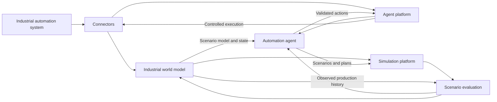

# Simulator Bot System Design and Delivery Plan

**English** | [简体中文](README.zh-CN.md)

This repository maintains system architecture, project boundaries, and cross-project design. Each engineering project maintains its own technical and module designs. Start with one bounded industrial pilot, connect field data to the world model, simulation, and evaluation, then build a controlled improvement loop.

## Objective and operating loop

The industrial automation agent is the core product. It observes equipment, processes, events, and constraints through field data, maps them into the world model, tests future scenarios, and uses the difference between predicted and observed outcomes to improve models and strategies. The agent platform releases validated changes.

## Engineering boundaries

The simulation solution, engine choice, and integration design proceed together once pilot needs are known. The simulation platform integrates the selected engine. Its internal adapter boundaries remain open.

| Project | Owns | Neighboring responsibilities |
| --- | --- | --- |
| industrial-automation-connectors | PLC, MES, SCADA, robot and camera connections, normalized telemetry, visual signals, events, and capabilities | Vision and agent inference, runtime, and platform permissions live elsewhere. |
| industrial-world-model | Equipment, flows, states, relationships, constraints and failure behavior, calibrated from real operations. Supplies versioned definitions, traceable histories, and point-in-time snapshots. | Agent planning and engine adaptation belong to their respective projects. |
| simulation-platform | Scenario construction, model integration, engine selection, reproducible runs and results | Consumes the shared model and field data through their owners. |
| automation-agent | Reads model state and constraints, learns how real operations map to simulation, plans, interprets results, and improves strategies | Uses model interfaces, connector capabilities and platform-managed permissions and runtime. |
| scenario-evaluation | Compares simulation with actual outcomes, maintains cases, metrics and regression checks, evaluates agents and models | Production execution belongs to the platform. |
| automation-agent-platform | Runs and coordinates agents, tools and workflows, manages authorization, controlled execution and audit | Protocols, model semantics, and simulation engine internals have separate owners. |

## Delivery sequence

### 1. Define a verifiable pilot

Select an automation system and representative scenario. Identify the equipment, flows, states, constraints, events, and actions involved. Define measurable outcomes and distinguish simulation-only actions from controlled field trials.

**Acceptance.** Document scope, data, operations, success metrics, and execution boundaries. Confirm that existing records or controlled collection can reproduce the case.

### 2. Connect a field system

Normalize telemetry, state changes, camera signals, events, and available operations through industrial-automation-connectors. Separate raw video from structured signals. Establish readable data, consistent timestamps and equipment IDs, then verify operations and permissions.

**Acceptance.** Consumers can read the required state and events, trace sources, timestamps and IDs, and inspect supported operations and limits.

### 3. Build the pilot world model

Maintain behavior templates, point-bound instances, handoffs, buffer rules, and resource occupancy. Reconstruct states and failure behavior from events. Distinguish completion, departure, and downstream receipt. Calibrate processing and changeover by operating condition, with versions and provenance.

**Independent acceptance.** Replay a real shift segment for two adjacent machines and one handoff. An engineer checks individual timelines against events and retrieves equipment state, work in progress, occupied resources, and unknowns at the handoff. Agent and simulator read the same version. Extend along routes and shared resources to an area, then connect areas through logistics, work orders, and schedules.

### 4. Run future scenarios

Define objects, behaviors, inputs, and outputs before choosing an engine. The agent selects a candidate change. Simulation-platform reads the snapshot and runs baseline and candidate under identical initial conditions. Refine engine integration and internal adapters as the pilot validates them.

**Acceptance.** Runs are reproducible and linked to model version, scenario definition, and inputs. Results are available to the agent and evaluation.

### 5. Establish evaluation and agent feedback

Scenario-evaluation stores cases, observed outcomes, and metrics. The agent uses field observations and model state to propose plans, interpret simulation results, and suggest model or strategy changes based on error. World-model changes are versioned and evaluated.

**Acceptance.** Compare predictions and actuals on the same cases. Reproduce evaluations and regression checks. Trace recommendations to inputs, model version, runs, and evidence.

### 6. Release validated changes under control

Integrate the agent, connectors, simulation, and evaluation with automation-agent-platform for workflow execution, authorization, control, and auditing. Only evaluated changes within the pilot's agreed scope qualify for controlled field validation.

**Acceptance.** Trace each execution to its initiator, permissions, model and strategy versions, evaluation, and result. Block unauthorized or unvalidated operations.

### 7. Expand with evidence

Once the pilot is stable, reuse the connector, model, simulation, and evaluation interfaces for additional equipment and systems. Retain previous regression cases.

**Acceptance.** New scenarios fit the workflow. Compare new and old models and strategies and check performance on existing cases.

## Design commitments

- Model relevant states, flows, relationships, constraints, and failures. Three-dimensional visualization is one possible presentation.
- Select an engine from demonstrated pilot requirements. Defer multi-engine abstraction until needed.
- Use repeatable cases, metrics, and actual outcomes to justify improvements.
- The agent owns understanding, planning, and improvement. The platform owns runtime, authorization, execution, and audit. Connectors own field integration.
- Route real operations through the agent platform's authorization and validation controls.

## Current priorities

Define one pilot and its limits, connect its field system, map observations to the world model, design and run simulation, establish evaluation and the agent's reality-to-simulation mapping, then integrate the validated workflow for controlled field trials.

## Documentation languages

Maintain English and Simplified Chinese editions together. The unsuffixed Markdown file is the public English entry point. Use the same basename with `.zh-CN.md` for Chinese, link both editions, and update both when the design changes.
