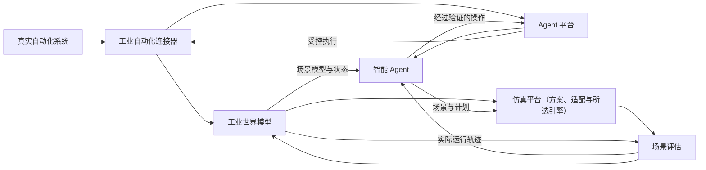

# Simulator Bot 设计方案与执行计划

[English](README.md) | **简体中文**

本仓库维护 Simulator Bot 的整体架构、工程边界和跨工程设计。某个工程的专项技术方案及模块设计，放在对应工程内维护。

本文说明 Simulator Bot 的系统方案、工程边界和落地顺序。当前以一个范围明确的工业自动化场景为试点，先打通真实运行数据、世界模型、仿真和结果评估，再逐步形成可控的改进闭环。

## 目标与工作闭环

智能 Agent 是核心产品。它从真实工业运行中观察设备、流程、事件和约束，将现场信息映射到世界模型，在仿真中验证未来场景，再依据预测与实际结果的差异改进模型和操作策略。经过验证的变更由 Agent 平台受控发布。

运行闭环：

**观察真实运行 → 映射到世界模型 → 仿真未来场景 → 对照预测与实际结果 → 改进模型和 Agent → 通过 Agent 平台发布经过验证的改进。**

## 工程边界

工程体系由六个职责明确的项目组成。模型、仿真、Agent 和平台分别承担不同职责，避免把学习推理、场景数据、仿真引擎和现场执行混在同一层。

**仿真设计状态：** 仿真方案和具体引擎尚未确定。因此，现阶段把方案设计、引擎选型和接入设计作为同一条工作流推进；待试点需求和技术方案明确后，再细化仿真平台内部适配器与引擎之间的接口和职责。`simulation-platform` 表示仿真能力的工程范围，不代表要自行开发仿真引擎。

| 工程 | 主要职责 | 不负责 |
| --- | --- | --- |
| `industrial-automation-connectors` | 连接 PLC、MES、SCADA、机器人、工厂摄像头及其他自动化系统；统一设备遥测、视觉信号、事件和可用操作。 | 视觉和 Agent 推理、运行时、平台级权限管理。 |
| `industrial-world-model` | 描述并维护设备、流程、状态、关系、约束和故障行为；根据真实运行数据校准场景模型，并通过稳定接口提供版本化模型、可溯源工件轨迹和指定时刻的场景快照。 | Agent 的任务规划和策略推理；仿真引擎适配。 |
| `simulation-platform` | 负责仿真方案的工程化；根据试点需要设计模型接入、场景构建、仿真运行和结果读取，并集成选定的仿真引擎。具体引擎和内部适配边界待方案阶段确定。 | 定义共享世界模型；现场设备连接。 |
| `automation-agent` | 通过世界模型接口读取场景状态、关系和约束；学习真实运行与仿真之间的映射、规划任务、解释仿真结果并改进策略。 | 直接管理设备连接、权限或生产运行时；绕过模型接口维护世界模型。 |
| `scenario-evaluation` | 比较仿真预测与实际结果；维护测试场景、指标、回归检查，评估模型和 Agent。 | 执行生产操作。 |
| `automation-agent-platform` | 运行和协调 Agent、工具与工作流；管理运行时、权限、执行控制和审计记录。 | 定义设备协议、世界模型或仿真引擎内部实现。 |

## 落地方案

### 1. 先限定一个可验证的试点

选择一种自动化系统和一个代表性场景，明确要观察的设备、流程、状态、约束、事件和可用操作。为该场景定义可记录的实际结果和成功指标，并明确哪些操作只允许仿真、哪些操作可以进入受控现场验证。

**交付与验收：** 形成试点范围说明、数据与操作清单、场景成功指标及现场操作边界；试点能用已有数据或受控采集方式复现。

### 2. 接入一种自动化系统

通过 `industrial-automation-connectors` 连接试点系统，将设备遥测、状态变化、摄像头/视觉信号、事件和可用操作整理为稳定接口。视频媒体流和结构化信号按各自的数据路径接入；先确保数据可读取、时间戳和设备标识一致，再逐步验证操作接口及其权限边界。

**交付与验收：** 上层能够通过统一接口读取试点所需状态和事件；数据来源、时间和设备标识可追溯；操作能力及其边界有明确记录。

### 3. 建立试点的工业世界模型

通过 `industrial-world-model` 维护设备行为模板、绑定现场点位的实例，以及设备间的交接、缓存和资源占用规则。按事件重建状态和故障行为，区分加工结束、工件离站与下游接收。用真实轨迹校准加工、换型等参数，记录适用工况、模型版本与来源。

**独立验收。** 选两台相邻设备、一次交接和一段真实班次日志。现场人员能逐件核对动作时间线，追溯到源事件，并读取交接时刻的设备状态、在制品、资源占用和未知项。Agent 和仿真平台通过同一读取接口取得模型与快照。后续沿工艺路由和共享资源扩展到片区，再按跨区物流、工单和排程扩展到全厂。

### 4. 将模型接入仿真并运行未来场景

先围绕试点设计仿真方案，明确需要模拟的对象、行为、输入和结果，再选择一个合适的仿真引擎。由 `automation-agent` 选择候选变更，`simulation-platform` 读取世界模型快照，在相同初始条件下运行原配置和候选配置。通过该平台完成模型接入、场景构建、仿真运行和结果读取；初期可将引擎选型与接入设计作为同一工作流，接口边界随方案验证逐步明确。

**交付与验收：** 同一场景和输入可以重复运行；仿真输出能关联到模型版本、场景定义和输入条件；仿真结果可供 Agent 与评估流程使用。

### 5. 建立评估基线并实现 Agent 闭环

通过 `scenario-evaluation` 保存代表性场景、实际结果和评估指标。`automation-agent` 结合连接器提供的真实运行信息与世界模型中的场景状态，提出仿真场景与计划，解释仿真结果，并依据预测误差提出模型或策略改进；模型变更由世界模型按版本管理，并经过评估验证。

**交付与验收：** 能够对同一组场景比较预测与实际结果；评估结果可复现并支持回归检查；Agent 的建议能追溯到输入、模型版本、仿真结果和评估依据。

### 6. 通过平台受控发布经过验证的改进

将 Agent、连接器、仿真和评估流程接入 `automation-agent-platform`。平台负责工作流运行、权限校验、执行控制和审计。只有经过场景评估并符合试点操作边界的变更，才进入受控现场验证。

**交付与验收：** 每次执行均可追溯到发起方、权限、模型与策略版本、评估结果和执行结果；未授权或未通过验证的操作不能进入现场执行流程。

### 7. 根据证据扩展

试点闭环稳定后，沿用连接器、世界模型、仿真平台和评估接口，扩展到更多设备、系统与场景。每次扩展都保留已有回归场景，比较新旧模型和策略的结果。

**交付与验收：** 新场景可以接入既有流程；扩展不会降低已覆盖场景的评估表现；模型和策略变化有可比较的版本记录。

## 关键设计约定

- **模型表达运行行为：** 世界模型描述目标场景所需的状态、流程、关系、约束和故障行为；三维可视化只是呈现方式之一。
- **先设计仿真方案：** 仿真引擎尚未选定；先根据试点场景确定仿真需求，再验证引擎和接入方案。暂不为多引擎扩展预设复杂接口。
- **评估贯穿迭代：** 模型或策略的改进应由可重复场景、测量指标和实际结果支持。
- **职责分层：** Agent 负责理解、规划和改进；平台负责运行、权限、执行控制和审计；连接器负责现场系统接入。
- **受控现场操作：** 面向真实系统的操作经 Agent 平台管理，并遵循明确的权限和验证流程。

## 当前优先级

1. 明确一个试点系统、场景、指标和操作边界。
2. 完成该系统的连接器和统一状态、事件接口。
3. 定义试点的工业世界模型及现场数据映射。
4. 设计仿真方案、选择试点引擎，并在 `simulation-platform` 项目中运行可重复的未来场景。
5. 建立场景评估基线，并实现 Agent 的现实到仿真映射。
6. 将验证通过的流程接入 Agent 平台，逐步开展受控现场验证。

## 文档语言

项目文档同时维护英文和简体中文版本。对外默认入口使用无语言后缀的英文 Markdown 文件，中文版使用同名的 `.zh-CN.md` 文件。两版相互链接，设计变更同步更新。
